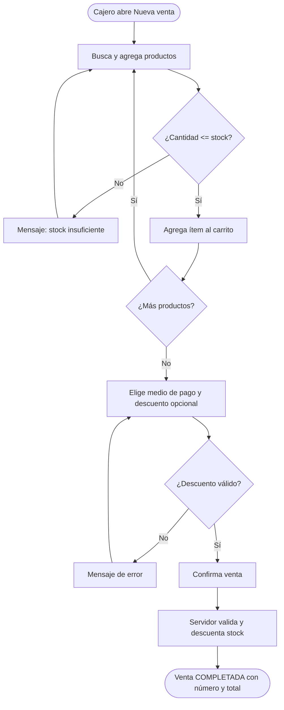
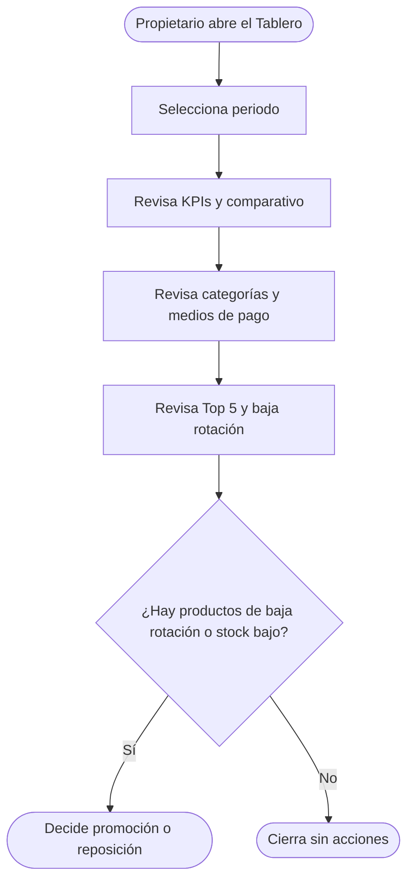
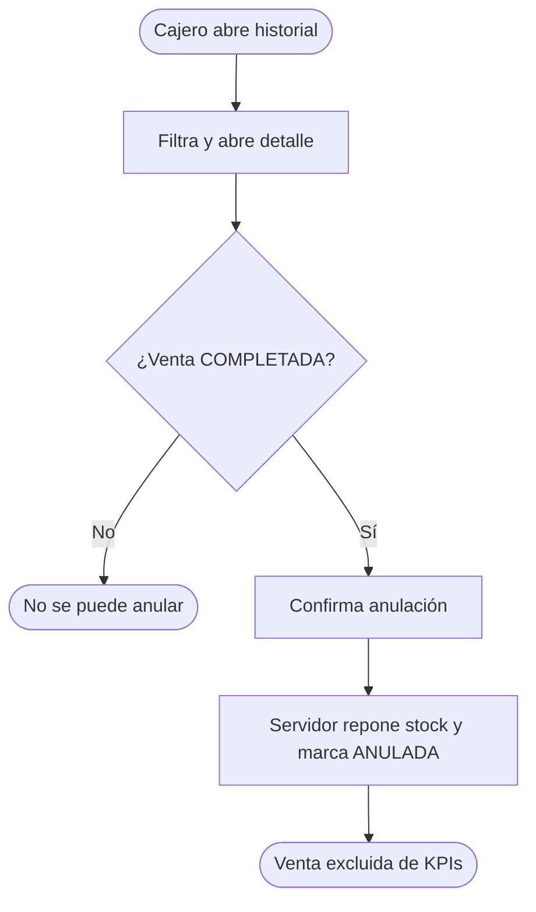

# PRD: Gestión de ventas de un supermercado de barrio

| Campo | Detalle |
| :--- | :--- |
| **Producto** | MiMercado Ventas (prototipo web) |
| **Versión** | 1.0, **APROBADO** |
| **Caso de estudio** | Gestión de ventas de un supermercado (variante opcional de la guía de laboratorio) |
| **Stack previsto** | Spring Boot (API REST) + React + H2 en memoria |
| **Estado** | ☑ Aprobado por el usuario |

---

## 1. Problema y contexto

Un supermercado de barrio registra sus ventas diarias, pero el dueño no tiene una vista consolidada para entender cómo va el negocio. Al cierre del día o del mes no puede responder rápido preguntas como: ¿cuánto vendí?, ¿con qué margen?, ¿qué productos me dejan más dinero?, ¿cuáles no se están moviendo?, ¿cómo me pagan los clientes?

**Historia de usuario central**

> Como dueño de un supermercado, cuando hago el cierre del día o del mes, quiero ver mis ventas, márgenes, productos más y menos vendidos y medios de pago, para decidir qué productos reponer, cuáles promocionar y cómo va mi negocio frente al periodo anterior.

## 2. Objetivos del producto

| ID | Objetivo |
| :--- | :--- |
| OB-1 | Consolidar las ventas de un periodo en un tablero legible en menos de un minuto. |
| OB-2 | Registrar ventas de mostrador de forma rápida, controlando el stock disponible. |
| OB-3 | Identificar productos más vendidos y de baja rotación para apoyar decisiones de reposición y promoción. |
| OB-4 | Comparar el desempeño del periodo actual contra el periodo anterior equivalente. |

### Métricas de éxito (referencia)

- Tiempo para consolidar un cierre de periodo: de manual (horas) a consulta en tablero (segundos).
- Porcentaje de ventas registradas sin errores de stock (objetivo: 100 % de las ventas validadas).
- Número de productos de baja rotación identificados por consulta.
- Diferencia entre el total del tablero y la suma del historial de ventas del mismo periodo (objetivo: 0).

## 3. Usuarios

| Persona | Descripción | Necesidades |
| :--- | :--- | :--- |
| **Propietario/a** (Carlos) | Dueño del negocio, revisa números al cierre. | Tablero, comparativos, productos top y de baja rotación. |
| **Cajero/a** (Laura) | Registra ventas durante el día. | Registro rápido, validación de stock, historial para consultar y anular errores. |

> En esta versión **no hay autenticación**: ambos perfiles usan la misma aplicación.

## 4. Alcance

### 4.1 Incluido (MVP)

| Módulo | Propósito |
| :--- | :--- |
| **M1. Tablero de ventas** | Resumen ejecutivo del periodo: KPIs, tendencia, categorías, medios de pago, top productos. |
| **M2. Ventas** | Registrar una venta, consultar historial con filtros, ver detalle y anular. |
| **M3. Productos y rotación** | Catálogo con stock, alerta de stock bajo y detección de baja rotación. |

### 4.2 Fuera de alcance (primera versión)

- Facturación electrónica y relación con entidades tributarias.
- Contabilidad completa, impuestos (IVA) y cierres contables.
- Pasarelas de pago reales y comercio electrónico.
- Nómina, turnos y gestión de personal.
- Autenticación, roles y permisos.
- Compras a proveedores y gestión de proveedores.
- Devoluciones parciales y notas crédito (solo existe la anulación total de una venta).
- Multi-sucursal, lectores de código de barras y otro hardware.
- Clientes registrados y programas de fidelización (las ventas son anónimas).

> Cualquier ampliación exige actualizar este PRD, la especificación técnica y el plan de trabajo.

## 5. Requisitos funcionales

Prioridad: **P0** = imprescindible para el MVP · **P1** = deseable en el MVP si hay tiempo · **P2** = mejora futura.

### M1. Tablero de ventas

| ID | Requisito | Criterio de aceptación | Prior. |
| :--- | :--- | :--- | :---: |
| RF-01 | Mostrar KPIs del periodo seleccionado: ventas totales, número de ventas, ticket promedio, margen bruto (valor y %). | Los valores coinciden con el cálculo de las reglas RN-03 a RN-05 sobre las ventas completadas del periodo. | P0 |
| RF-02 | Mostrar ventas por día del periodo. | Una serie con un valor por día (0 si no hubo ventas); la suma iguala las ventas totales. | P0 |
| RF-03 | Mostrar ventas por categoría. | Una entrada por categoría con ventas y porcentaje; la suma iguala las ventas totales. | P0 |
| RF-04 | Mostrar ventas por medio de pago. | Una entrada por medio de pago con total y número de ventas. | P0 |
| RF-05 | Comparar con el periodo anterior equivalente. | Variación porcentual de ventas totales y de margen frente al periodo anterior de igual duración (RN-08). Si el anterior es 0, se indica «sin base de comparación». | P1 |
| RF-06 | Mostrar el Top 5 de productos más vendidos. | Ordenado por unidades vendidas descendente, con unidades y valor. | P0 |
| RF-07 | Seleccionar el periodo del tablero. | Atajos (hoy, últimos 7 días, mes actual, últimos 30 días) y rango personalizado; todos los widgets se actualizan. | P0 |

### M2. Ventas

| ID | Requisito | Criterio de aceptación | Prior. |
| :--- | :--- | :--- | :---: |
| RF-08 | Listar ventas con paginación y filtros (rango de fechas, medio de pago, estado). | Los filtros cambian los resultados; orden por fecha descendente por defecto. | P0 |
| RF-09 | Ver el detalle de una venta. | Muestra número, fecha, medio de pago, estado, ítems (producto, cantidad, precio, subtotal), descuento y total. | P0 |
| RF-10 | Registrar una venta con uno o más ítems, medio de pago y descuento opcional. | Se aplican RN-01 y RN-02; si falla una validación no se registra nada y se muestra un mensaje claro. | P0 |
| RF-11 | Anular una venta completada. | Cambia a `ANULADA`, repone el stock y la venta deja de contar en los KPIs (RN-06). No se puede anular dos veces. | P0 |

### M3. Productos y rotación

| ID | Requisito | Criterio de aceptación | Prior. |
| :--- | :--- | :--- | :---: |
| RF-12 | Listar productos con búsqueda por nombre/SKU y filtros por categoría y estado de stock. | Filtros funcionales; muestra stock actual y mínimo; resalta stock bajo. | P0 |
| RF-13 | Filtrar productos con stock bajo. | Solo productos activos con `stock actual <= stock mínimo` (RN-07). | P0 |
| RF-14 | Listar productos de baja rotación. | Solo productos activos sin ventas completadas en los últimos N días (por defecto 30, ajustable) (RN-09). | P0 |
| RF-15 | Crear y editar un producto. | Validaciones de campos obligatorios, SKU único y valores no negativos. | P1 |
| RF-16 | Activar / desactivar un producto. | Un producto inactivo no puede venderse ni aparece en alertas. | P1 |
| RF-17 | Listar categorías. | Devuelve las categorías para filtros y formularios. | P0 |

## 6. Reglas de negocio

> Estas reglas deben ser **aprobadas por el humano** antes de implementar.

| ID | Regla |
| :--- | :--- |
| RN-01 | `total = suma(subtotales de ítems) − descuento`. El descuento es un valor monetario, `0 <= descuento <= suma de subtotales`. |
| RN-02 | No se puede vender una cantidad mayor al stock actual. Al registrar una venta se descuenta el stock; todo ocurre en una sola transacción. Solo se venden productos activos. |
| RN-03 | **Ventas totales** = suma de `total` de las ventas con estado `COMPLETADA` del periodo. |
| RN-04 | **Ticket promedio** = ventas totales / número de ventas completadas (0 si no hay ventas). |
| RN-05 | **Margen bruto** = suma de `(precio unitario − costo unitario) × cantidad` de los ítems, menos el descuento de cada venta. **Margen %** = margen bruto / ventas totales. El costo y el precio se guardan en el ítem al vender (historial inmutable). |
| RN-06 | Las ventas `ANULADA` no participan en ningún KPI, gráfico ni ranking. Anular repone el stock de cada ítem. |
| RN-07 | **Stock bajo:** producto activo con `stock actual <= stock mínimo`. |
| RN-08 | **Periodo anterior equivalente:** mismo número de días inmediatamente anterior al periodo seleccionado. |
| RN-09 | **Baja rotación:** producto activo sin ventas completadas en los últimos N días (N = 30 por defecto). |
| RN-10 | Medios de pago válidos: `EFECTIVO`, `TARJETA`, `TRANSFERENCIA` (registro informativo; no hay cobro real). |
| RN-11 | Moneda: pesos colombianos (COP). Fechas y horas en zona horaria local. |
| RN-12 | El prorrateo del descuento por categoría en RF-03 se hace proporcional al subtotal de cada ítem. |

## 7. Requisitos no funcionales

| ID | Requisito | Criterio comprobable |
| :--- | :--- | :--- |
| RNF-01 | Rendimiento | Cada endpoint responde en < 1 s con los datos semilla. |
| RNF-02 | Usabilidad | Registrar una venta de 3 ítems en menos de 1 minuto, sin ayuda. |
| RNF-03 | Diseño adaptable | Legible y sin desbordes entre 360 px y 1920 px de ancho. |
| RNF-04 | Accesibilidad | Contraste de texto AA (≥ 4.5:1), campos con etiqueta, navegación por teclado en formularios. |
| RNF-05 | Estados de la interfaz | Cada vista muestra carga, error de red y lista vacía sin bloquearse. |
| RNF-06 | Validación | Todas las reglas se validan en el servidor, no solo en el frontend. |
| RNF-07 | Manejo de errores | Las respuestas de error usan un formato único y no exponen trazas ni datos sensibles. |
| RNF-08 | Datos de prueba | Solo datos ficticios; H2 en memoria que se reinicializa al reiniciar. |
| RNF-09 | Documentación | API documentada con OpenAPI/Swagger y `README` con instrucciones reproducibles. |
| RNF-10 | Formato | Valores monetarios con formato COP (`es-CO`), sin pérdida de precisión (decimales exactos). |

## 8. Flujos principales

### 8.1 Registrar una venta

### 8.2 Cierre de periodo y decisión

### 8.3 Anular una venta

## 9. Vistas previstas (para diseñar en Stitch)

| Vista | Módulo | Contenido clave |
| :--- | :--- | :--- |
| Tablero | M1 | Selector de periodo, 4 KPIs, comparativo, gráfico por día, categorías, medios de pago, Top 5. |
| Historial de ventas | M2 | Tabla paginada con filtros y acceso a detalle. |
| Detalle de venta | M2 | Datos de la venta, ítems, total y botón Anular. |
| Nueva venta | M2 | Buscador de productos, carrito, medio de pago, descuento, total en vivo, confirmar. |
| Productos | M3 | Tabla con búsqueda, filtros, indicador de stock bajo y acciones de edición. |
| Baja rotación | M3 | Lista de productos sin ventas en N días con selector de N. |

Todas las vistas deben incluir estados de carga, vacío, error y confirmación.

## 10. Supuestos, riesgos y preguntas abiertas

**Supuestos**
- Ventas de mostrador anónimas, un solo punto de venta.
- Los precios incluyen impuestos; el IVA no se calcula en el MVP.
- El costo unitario es único por producto (sin costeo por lotes).

**Riesgos**
- Sin autenticación, el prototipo no es apto para datos reales.
- H2 en memoria: los datos se pierden al reiniciar.
- Concurrencia de ventas sobre el mismo producto no está optimizada (se mitiga con transacciones).

**Respuestas aprobadas:**
1. Reglas RN-01 a RN-12 aprobadas íntegramente (margen según RN-05 y baja rotación según RN-09 con N=30 días por defecto).
2. Descuento monetario fijo en COP (RN-01).
3. RF-15 (editar producto) y RF-16 (activar/desactivar producto) entran al MVP para gestión de catálogo.

## 11. Control de aprobación

| Revisor | Decisión | Fecha | Observaciones |
| :--- | :--- | :--- | :--- |
| Usuario (Propietario / Líder de Proyecto) | ☑ Aprobado | 2026-11-13 | PRD aprobado para desarrollo. Se procede a revisión de Mockups y Spec Técnica. |
