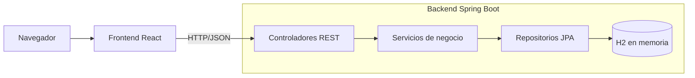
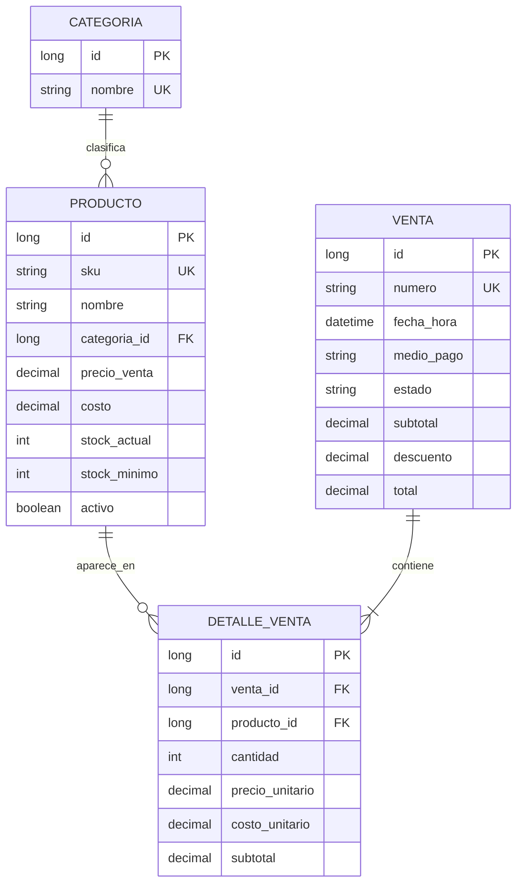

# SPEC-TECNICA: MiMercado Ventas

| Campo | Detalle |
| :--- | :--- |
| **Basada en** | `PRD.md` v1.0 Aprobado |
| **Versión** | 1.0, **APROBADO** |
| **Estado** | ☑ Aprobado por el usuario |

> **Pendiente de reconciliación:** esta especificación se redactó a partir del PRD. Cuando se exporten los mockups de Stitch (`mockups/stitch/`), se debe verificar que vistas, campos y filtros coincidan y actualizar este documento si hay diferencias.

---

## 1. Resumen de la solución

Aplicación web de dos capas: un **frontend React** que consume una **API REST en Spring Boot**, con persistencia en **H2 en memoria** y datos semilla. Sin autenticación en esta versión.



| Componente | Responsabilidad |
| :--- | :--- |
| Frontend React | Vistas, filtros, formularios, estados de carga/error/vacío, formato de moneda. |
| Controladores | Exponer rutas, validar entrada (Bean Validation), mapear a DTO y códigos HTTP. **Sin lógica de negocio.** |
| Servicios | Reglas de negocio (RN-xx), transacciones, cálculo de KPIs. |
| Repositorios | Acceso a datos con Spring Data JPA y consultas agregadas justificadas. |
| H2 | Base de datos en memoria; se reinicializa en cada arranque. |

## 2. Tecnologías y versiones

> No asumir versiones. Fijar las exactas en `pom.xml` / `package.json` al generar el proyecto y **registrarlas en esta tabla**.

| Tecnología | Propuesta | Versión real (completar) |
| :--- | :--- | :--- |
| Java (JDK) | 17 | 21.0.1 LTS |
| Spring Boot | 3.x estable compatible con Java 17 | 3.2.5 |
| Spring Web, Data JPA, Validation | Las de la versión de Spring Boot | 3.2.5 |
| H2 Database | La de Spring Boot | 2.2.224 |
| springdoc-openapi | Compatible con Spring Boot elegido | 2.5.0 |
| Maven Wrapper | Incluido (`mvnw`, `mvnw.cmd`) | 3.9.6 |
| Node.js / npm | LTS vigente | Node v24.20.0 / npm 11.19.0 |
| React + Vite | Versión estable vigente | React 18 / Vite 5 |
| React Router | Versión estable vigente | React Router DOM v6 |
| Librería de gráficos | Recharts (o similar) | |
| Pruebas backend | JUnit 5, Mockito, Spring Boot Test | |
| Pruebas frontend | Vitest + React Testing Library | |

## 3. Modelo de datos

### 3.1 Diagrama entidad-relación



### 3.2 Restricciones

| Entidad | Restricciones |
| :--- | :--- |
| `Categoria` | `nombre` obligatorio y único. |
| `Producto` | `sku` y `nombre` obligatorios; `sku` único; `precio_venta > 0`; `costo >= 0`; `stock_actual >= 0`; `stock_minimo >= 0`; `categoria_id` obligatorio. |
| `Venta` | `numero` único (formato `V-000001`); `medio_pago` ∈ {EFECTIVO, TARJETA, TRANSFERENCIA}; `estado` ∈ {COMPLETADA, ANULADA}; `descuento` entre 0 y `subtotal`; al menos un detalle. |
| `DetalleVenta` | `cantidad >= 1`; `precio_unitario` y `costo_unitario` copiados del producto al vender; no se repite el mismo producto dentro de una venta. |

Tipos monetarios: `BigDecimal` (`DECIMAL(12,2)`). Estados y medios de pago: `enum` guardado como `STRING`.

## 4. Estructura del backend

```text
backend/src/main/java/com/mimercado/ventas/
├── controller/    CategoriaController, ProductoController, VentaController, DashboardController
├── service/       ProductoService, VentaService, DashboardService
├── repository/    CategoriaRepository, ProductoRepository, VentaRepository, DetalleVentaRepository
├── model/         Categoria, Producto, Venta, DetalleVenta, MedioPago, EstadoVenta
├── dto/           request/ y response/ (records)
├── exception/     RecursoNoEncontradoException, StockInsuficienteException,
│                  ReglaNegocioException, ManejadorGlobalExcepciones (@RestControllerAdvice)
├── config/        CorsConfig, OpenApiConfig
└── seed/          CargadorDatosPrueba (perfil dev)
```

**Reglas de implementación**
- Los controladores no exponen entidades; usan DTO.
- `VentaService.registrar` y `anular` son `@Transactional`.
- Las consultas agregadas (por día, categoría, medio de pago, top, baja rotación) se resuelven en repositorio con JPQL/proyecciones, no cargando todo en memoria.
- Un único `@RestControllerAdvice` produce todos los errores (sección 5.3).

## 5. API REST

Base: `/api/v1`. Formato: JSON. Fechas ISO-8601 (`yyyy-MM-dd` para filtros). Puerto: **confirmar el configurado en `application.properties`** (no asumir).

### 5.1 Endpoints

| Requisito | Verbo y ruta | Parámetros / cuerpo | Respuesta |
| :--- | :--- | :--- | :--- |
| RF-17 | `GET /categorias` | | `200` lista de categorías |
| RF-12, RF-13 | `GET /productos` | `q`, `categoriaId`, `stockBajo` (bool), `activo` (bool), `page`, `size` | `200` página de productos |
| RF-12 | `GET /productos/{id}` | | `200` producto · `404` |
| RF-15 | `POST /productos` | cuerpo producto | `201` producto · `400` · `409` SKU duplicado |
| RF-15 | `PUT /productos/{id}` | cuerpo producto | `200` · `400` · `404` · `409` |
| RF-16 | `PATCH /productos/{id}/estado` | `{ "activo": true }` | `200` · `404` |
| RF-14 | `GET /productos/baja-rotacion` | `dias` (por defecto 30, mínimo 1) | `200` lista |
| RF-08 | `GET /ventas` | `desde`, `hasta`, `medioPago`, `estado`, `page`, `size` | `200` página de ventas |
| RF-09 | `GET /ventas/{id}` | | `200` detalle · `404` |
| RF-10 | `POST /ventas` | `{ medioPago, descuento, items:[{productoId, cantidad}] }` | `201` venta · `400` · `404` · `409` stock |
| RF-11 | `POST /ventas/{id}/anular` | | `200` venta · `404` · `409` ya anulada |
| RF-01, RF-05 | `GET /dashboard/resumen` | `desde`, `hasta` | `200` KPIs + comparativo |
| RF-02 | `GET /dashboard/ventas-por-dia` | `desde`, `hasta` | `200` serie |
| RF-03 | `GET /dashboard/ventas-por-categoria` | `desde`, `hasta` | `200` lista |
| RF-04 | `GET /dashboard/ventas-por-medio-pago` | `desde`, `hasta` | `200` lista |
| RF-06 | `GET /dashboard/top-productos` | `desde`, `hasta`, `limite` (por defecto 5) | `200` lista |

Los parámetros `desde` y `hasta` son obligatorios en `/dashboard/*`; si `desde > hasta` se responde `400`.

### 5.2 Ejemplos de contrato

**`POST /api/v1/ventas`**

```json
{
  "medioPago": "EFECTIVO",
  "descuento": 500.00,
  "items": [
    { "productoId": 3, "cantidad": 2 },
    { "productoId": 7, "cantidad": 1 }
  ]
}
```

**Respuesta `201`**

```json
{
  "id": 41,
  "numero": "V-000041",
  "fechaHora": "2026-11-13T10:25:00",
  "medioPago": "EFECTIVO",
  "estado": "COMPLETADA",
  "subtotal": 12400.00,
  "descuento": 500.00,
  "total": 11900.00,
  "items": [
    { "productoId": 3, "producto": "Leche entera 1L", "cantidad": 2,
      "precioUnitario": 4200.00, "subtotal": 8400.00 },
    { "productoId": 7, "producto": "Arroz 1kg", "cantidad": 1,
      "precioUnitario": 4000.00, "subtotal": 4000.00 }
  ]
}
```

**`GET /api/v1/dashboard/resumen?desde=2026-11-01&hasta=2026-11-13`**

```json
{
  "periodo": { "desde": "2026-11-01", "hasta": "2026-11-13" },
  "ventasTotales": 4850000.00,
  "numeroVentas": 38,
  "ticketPromedio": 127631.58,
  "margenBruto": 1210000.00,
  "margenPorcentaje": 24.95,
  "comparativo": {
    "desde": "2026-10-19", "hasta": "2026-10-31",
    "ventasTotales": 4300000.00,
    "variacionVentasPorcentaje": 12.79,
    "variacionMargenPorcentaje": 8.40
  }
}
```

> Los números son ilustrativos. Si el periodo anterior no tiene ventas, `variacion...` se devuelve `null` y el frontend muestra «sin base de comparación».

### 5.3 Formato de error unificado

```json
{
  "timestamp": "2026-11-13T10:25:00",
  "status": 409,
  "error": "Conflict",
  "message": "Stock insuficiente para 'Leche entera 1L': disponible 1, solicitado 2",
  "path": "/api/v1/ventas",
  "details": []
}
```

| Excepción | Código HTTP |
| :--- | :---: |
| Validación de Bean Validation / parámetros inválidos | `400` (con `details` por campo) |
| `RecursoNoEncontradoException` | `404` |
| `StockInsuficienteException`, venta ya anulada, SKU duplicado, producto inactivo | `409` |
| Cualquier otra excepción | `500` con mensaje genérico, **sin traza** |

## 6. Reglas de negocio en los servicios

| Regla | Dónde se implementa |
| :--- | :--- |
| RN-01 (total y descuento) | `VentaService.registrar`: calcula subtotal, valida descuento y total. |
| RN-02 (stock y transacción) | `VentaService.registrar`: valida activo y stock, descuenta, todo en una transacción; ante error, rollback completo. |
| RN-03 a RN-05 (KPIs y margen) | `DashboardService.resumen`: agrega solo ventas `COMPLETADA`; margen con `costo_unitario` del detalle menos descuento. |
| RN-06 (anulación) | `VentaService.anular`: repone stock y marca `ANULADA`; las consultas del tablero filtran por `COMPLETADA`. |
| RN-07 (stock bajo) | `ProductoRepository` / `ProductoService`: `activo = true AND stock_actual <= stock_minimo`. |
| RN-08 (periodo anterior) | `DashboardService`: `dias = hasta − desde + 1`; anterior = `[desde − dias, desde − 1]`. |
| RN-09 (baja rotación) | `ProductoRepository`: activos sin detalle en ventas completadas desde `hoy − N días`. |
| RN-12 (descuento por categoría) | `DashboardService.ventasPorCategoria`: descuento prorrateado por subtotal del ítem. |

## 7. Frontend

### 7.1 Estructura

```text
frontend/src/
├── pages/        TableroPage, VentasPage, VentaDetallePage, NuevaVentaPage,
│                 ProductosPage, BajaRotacionPage
├── components/   Layout, KpiCard, GraficoVentasDia, TablaPaginada, FiltrosVentas,
│                 SelectorPeriodo, CarritoVenta, EstadoVacio, EstadoError, Cargando,
│                 ConfirmarDialogo
├── services/     apiClient, ventasService, productosService, dashboardService
├── hooks/        useFetch (carga, error, datos)
└── utils/        formatoMoneda (es-CO, COP), formatoFecha
```

### 7.2 Rutas

| Ruta | Vista | Requisitos |
| :--- | :--- | :--- |
| `/` | Tablero | RF-01 a RF-07 |
| `/ventas` | Historial | RF-08 |
| `/ventas/nueva` | Nueva venta | RF-10 |
| `/ventas/:id` | Detalle y anular | RF-09, RF-11 |
| `/productos` | Productos | RF-12, RF-13, RF-15, RF-16 |
| `/productos/baja-rotacion` | Baja rotación | RF-14 |

### 7.3 Lineamientos

- La URL base de la API se lee de una variable de entorno (`VITE_API_URL`), no se escribe fija en los componentes.
- Los componentes no llaman a `fetch` directamente: usan los servicios.
- Cada vista maneja explícitamente carga, error con opción de reintentar y lista vacía (RNF-05).
- La validación del frontend es **complementaria**; el servidor es la autoridad (RNF-06).
- Formato de moneda con `Intl.NumberFormat('es-CO', { style: 'currency', currency: 'COP' })`.
- Los estilos siguen los mockups aprobados y el contraste AA (RNF-03, RNF-04).

## 8. Configuración

### 8.1 Backend (`application.properties`, valores de referencia)

```properties
spring.datasource.url=jdbc:h2:mem:mimercado;DB_CLOSE_DELAY=-1
spring.datasource.username=sa
spring.datasource.password=
spring.jpa.hibernate.ddl-auto=create-drop
spring.jpa.open-in-view=false
spring.h2.console.enabled=true          # solo desarrollo
spring.h2.console.path=/h2-console
spring.profiles.active=dev
```

- Consola H2 **únicamente en el perfil `dev`**.
- CORS: permitir solo el origen local del frontend (el que muestre Vite) y métodos GET, POST, PUT, PATCH.
- Sin secretos en el repositorio.

### 8.2 Datos semilla (`CargadorDatosPrueba`, perfil `dev`)

Datos 100 % ficticios y **deterministas** (semilla fija de aleatoriedad). Las fechas son relativas a «hoy» para que el tablero siempre tenga datos recientes.

- **5 categorías:** Lácteos y huevos, Abarrotes, Bebidas, Aseo y hogar, Snacks y dulces.
- **20 productos** (4 por categoría), con precios en COP, costos con margen del 15 al 40 %.
- **Casos de prueba incluidos:**
  - **3 productos con stock bajo** (`stock_actual <= stock_minimo`).
  - **3 productos de baja rotación** (sin ventas en los últimos 30 días).
  - **1 producto inactivo.**
- **~60 ventas completadas** repartidas en los últimos 60 días, con los tres medios de pago, algunas con descuento.
- **3 ventas anuladas** para verificar que no cuentan en los KPIs.

## 9. Plan de pruebas

### 9.1 Automatizadas (backend)

| Prueba | Verifica |
| :--- | :--- |
| `VentaServiceTest.registra_descuentaStock` | RN-01, RN-02 |
| `VentaServiceTest.rechazaStockInsuficiente_sinCambios` | RN-02, rollback |
| `VentaServiceTest.rechazaDescuentoMayorAlSubtotal` | RN-01 |
| `VentaServiceTest.anular_reponeStock_yNoSeAnulaDosVeces` | RN-06 |
| `DashboardServiceTest.kpis_excluyenAnuladas` | RN-03 a RN-06 |
| `DashboardServiceTest.periodoAnterior_equivalente` | RN-08 |
| `ProductoRepositoryTest.stockBajo_y_bajaRotacion` | RN-07, RN-09 |
| `VentaControllerTest` (MockMvc) | Códigos 201, 400, 404, 409 y formato de error |

### 9.2 Matriz funcional (manual) y trazabilidad

| ID | Prueba | Requisitos | Resultado esperado |
| :--- | :--- | :--- | :--- |
| P01 | Abrir el tablero | RF-01 a RF-07 | KPIs y gráficos coherentes con la API. |
| P02 | Consultar productos | RF-12 | Tabla con datos del backend y campos legibles. |
| P03 | Filtrar stock bajo | RF-13 | Solo los productos que cumplen RN-07 (3 en la semilla). |
| P04 | Productos de baja rotación | RF-14 | Solo los que cumplen RN-09 (3 en la semilla); cambiar N actualiza el resultado. |
| P05 | Historial y filtros de ventas | RF-08, RF-09 | Filtros por fecha, medio de pago y estado cambian los resultados; detalle correcto. |
| P06 | Registrar una venta | RF-10 | Se crea, el stock baja y el tablero refleja el cambio. |
| P07 | Datos vacíos o API caída | RNF-05 | Mensaje útil y la interfaz no se bloquea. |
| P08 | Validar formularios y reglas | RF-10, RF-15, RNF-06 | Campos obligatorios, stock excedido y descuento inválido bien manejados. |
| P09 | Anular una venta | RF-11 | Stock repuesto y la venta sale de los KPIs; segunda anulación rechazada. |
| P10 | Recargar y reiniciar backend | RNF-08 | Se documenta que los datos de H2 se reinicializan. |
| P11 | Diseño adaptable | RNF-03 | Legible entre 360 y 1920 px. |

Estados permitidos: `APROBADA`, `FALLIDA`, `PENDIENTE`. Una prueba no ejecutada es `PENDIENTE`.

## 10. Fases de implementación y criterios de finalización

| Fase | Contenido | Criterio de finalización |
| :--- | :--- | :--- |
| I1. Backend base | Proyecto, entidades, repositorios, semilla, H2. | Arranca sin errores; un `GET` devuelve datos semilla. |
| I2. Lógica de negocio | Servicios de ventas, productos y dashboard; manejo global de errores. | Pruebas automatizadas de la sección 9.1 en verde. |
| I3. API y documentación | Controladores, DTO, validaciones, OpenAPI, CORS. | Todos los endpoints de 5.1 responden; Swagger accesible. |
| I4. Frontend | Layout, servicios, vistas, estados, formato COP. | Todas las vistas muestran datos reales del backend. |
| I5. Integración y pruebas | Matriz P01–P11, correcciones, `README`. | Matriz con evidencia real; `README` reproducible. |
| I6. Revisión de calidad | Trazabilidad, seguridad, deuda técnica. | `HALLAZGOS-CALIDAD.md` completo. |

## 11. Trazabilidad requisito → componente

| Requisito | Endpoint | Servicio | Vista | Prueba |
| :--- | :--- | :--- | :--- | :--- |
| RF-01, RF-05 | `GET /dashboard/resumen` | `DashboardService` | Tablero | P01 |
| RF-02 | `GET /dashboard/ventas-por-dia` | `DashboardService` | Tablero | P01 |
| RF-03 | `GET /dashboard/ventas-por-categoria` | `DashboardService` | Tablero | P01 |
| RF-04 | `GET /dashboard/ventas-por-medio-pago` | `DashboardService` | Tablero | P01 |
| RF-06 | `GET /dashboard/top-productos` | `DashboardService` | Tablero | P01 |
| RF-07 | (parámetros `desde`/`hasta`) | n/a | Tablero | P01 |
| RF-08, RF-09 | `GET /ventas`, `GET /ventas/{id}` | `VentaService` | Historial, Detalle | P05 |
| RF-10 | `POST /ventas` | `VentaService` | Nueva venta | P06, P08 |
| RF-11 | `POST /ventas/{id}/anular` | `VentaService` | Detalle | P09 |
| RF-12, RF-13 | `GET /productos` | `ProductoService` | Productos | P02, P03 |
| RF-14 | `GET /productos/baja-rotacion` | `ProductoService` | Baja rotación | P04 |
| RF-15, RF-16 | `POST/PUT/PATCH /productos` | `ProductoService` | Productos | P08 |
| RF-17 | `GET /categorias` | `ProductoService` | Filtros y formularios | P02 |

## 12. Limitaciones y deuda técnica conocida

- Sin autenticación ni autorización: **no apto para datos reales**.
- H2 en memoria: los datos no persisten; migrar a una base de datos persistente y a migraciones versionadas antes de producción.
- Sin control de concurrencia optimista (se mitiga con transacciones); evaluar bloqueo/versionado para alto volumen.
- Sin IVA, devoluciones parciales, clientes ni multi-sucursal (ver PRD, sección 4.2).
- Consola H2 y CORS abiertos solo para desarrollo.

## 13. Control de aprobación

| Revisor | Decisión | Fecha | Observaciones |
| :--- | :--- | :--- | :--- |
| Usuario (Líder Técnico / Dueño) | ☑ Aprobado | 2026-11-13 | Arquitectura reconciliada con mockups de Stitch y PRD v1.0. Autorizado inicio de implementación backend (Fase 4). |

> Tras la aprobación, el agente puede pasar a la implementación (fases I1 a I6).
